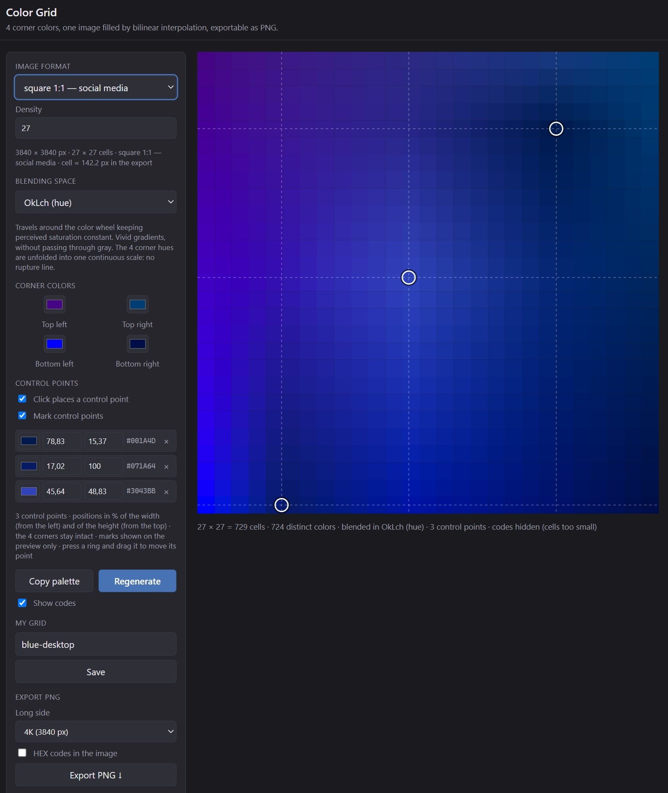

# Color Grid

Four colors at the four corners, and the whole image filled with **bilinear interpolation**.
A plain web page: no build, no framework, no dependency — open it and paint.



### → [Try it online](https://pmousse.github.io/color-blending-html/)

## What it does

**The frame**

- 13 formats (square 1:1, desktop 16:9, phone 9:16, ultrawide 21:9, 4:3, 3:4, 3:2, 2:3, 5:4, 4:5,
  2:1, 1:2) plus a **custom size** typed by hand.
- **Density** 1–64: cells along the *short* side, the long side following the ratio with whole
  cells, so cells stay square and the format stays exact.
- Export at an exact **long side**: 1K, 2K, 2.5K, 4K, 4K+.

**The colors**

- 4 corner pickers — or click straight on a corner cell of the preview.
- **6 blending spaces** for the intermediate cells: sRGB, Linear, OkLab, Oklch, HSL, HSV. The
  cylindrical ones unfold the 4 corner hues into one continuous scale first, so no rupture line
  cuts the gradient (the worst neighbouring jump goes from 179° down to about 15°).
- A cell is one flat color: the HEX code read from it is the very color painted in the PNG.

**Control points**

- Click anywhere inside the image to plant a color: up to **16** points, each opening one control
  row and one control column through the frame.
- **Drag its ring** to move it — the gradient bends under the pointer while you drag.
- A point is kept as a **percentage of the image**, so it survives a change of format or of density.
- Corners stay theirs: a control point can never replace one.

**Getting it out**

- **Export PNG** at the exact pixel size asked for, one cell painted per cell, HEX codes painted in
  only if you ask.
- A file name that says what was painted: `colorgrid_blue-desktop_27x27_d27_1x1_oklch_cp3_3840x3840.png`.
- **Copy palette** for the distinct codes, `Shift` + click to copy one cell's code.
- Grids **saved in the browser** (localStorage): name, format, density, resolution, space, points.

**The address is the work**

Every setting — format, density, resolution, space, name, corner colors, control points, the codes
shown or painted — lives in the URL fragment. Copy the link, send it, the page opens exactly as it
was left. `#F=16x9&n=11&sp=oklch&nm=blue-desktop&P=22x30_000000*50x50_ff00ff`

## How it works

```
x = col / (cols - 1)          y = 1 - row / (rows - 1)

c = (1-y) · [(1-x) · BL + x · BR]  +  y · [(1-x) · TL + x · TR]
```

The plain bilinear pass, checked cell by cell against an independent Python implementation. With
control points, the frame becomes a lattice and each patch is blended with this same pass — with no
point at all, the result is exactly the plain grid.
[Full documentation → DETAILS.md](DETAILS.md)

## Files

| File | |
|---|---|
| `index.html` | the page |
| `app.js` | settings, frame and density, control points, preview, export, address |
| `colorspaces.js` | the 6 blending spaces, the hue unwrapping, the control point lattice |
| `storage.js` | saved grids in localStorage |
| `styles.css` | everything |
| `DETAILS.md` | the long documentation |
| `.t/` | dev tooling: 220 interface checks, 123 color math checks, a Python reference |

Vanilla HTML, CSS and JavaScript. Works straight from the files (`file://`), no server needed.

## Running the checks

```bash
cd .t && npm install     # jsdom, once
node .t/ui.mjs           # the interface  → 220 passed, 0 failed
node .t/spaces.cjs       # the color math → 123 passed, 0 failed
python .t/ref.py         # parity with an independent Python implementation → identical
```

## Notes assumed

- Colors coming out of a 3D tool are usually stored as **linear** light, while the page works in
  sRGB. Grids made elsewhere are not translated, they start fresh.
- Corner colors and copied codes stay plain sRGB HEX whatever the blending space.
- Control point rings are drawn on the preview only, never in the exported PNG.
